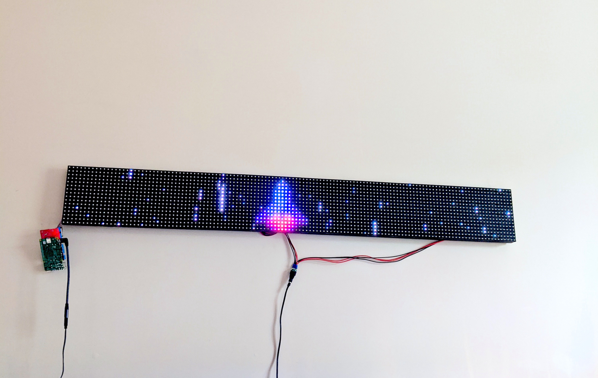

# **|||** Obelisk

[Project website and installation guide](https://obelisk-sachasayan.netlify.app/)



## What is Obelisk? 

Obelisk is a framework and starter project for getting interactive code running on standard outdoor billboard LED panels via the web browser, based on a body of incredible work done by [Henner Zeller](https://github.com/hzeller/rpi-rgb-led-matrix) and [Alexander Eden](https://github.com/alexeden/rpi-led-matrix). 

## Hardware requirements


```
TL;DR: 
- You need panels
- You need 16-pin IDC ribbon cables to connect your panels
- You need power cables for your panels, which should have been supplied with them
- You need a power supply, with which to hook up your panels
- You need a controller, in this case a Raspberry Pi (3/4). 
- You need something to adapt the GPIO pins from a Raspberry Pi to the common 16-pin IDC format used by these kinds of LED panels
```

You'll need a set of panels meant for outdoor or indoor signage, such as [these](https://www.aliexpress.com/item/32382300128.html). Typically, they're bought in the dozens or hundreds for massive outdoor displays, but these boards aren't difficult to find on sites like Ebay or Aliexpress in small quantities. The boards I'm using are made by a company called LysonLed that sells their panels [here](https://www.aliexpress.com/store/709678).

**There are two main types of panels:**

- Indoor panels tend to be higher resolution, and cheaper. 
- Outdoor panels tend to be brighter and have higher refresh rates, usually at the expense of resolution and with increased cost. Outdoor panels also come with circuitry waterproofing, which may or may not be beneficial depending on your needs, but is almost always a plus. 

**Things to look out for when shopping for panels:**

- **Physical dimensions**, which are a product of....
- **Dot Pitch**, signified by P1, P5, P10, etc. 
	-	The pitch number represents how detailed a display is. The smaller the number, the closer the pixels are together. 
  - The number itself meaures distance in mm between each pixel. 
  - This means that a P10 32x32 panel will always be 320mm x 320mm in total dimensions, a P5 32x32 panel will be 160mm x 160mm, and so on. 
- and **Resolution**, most commonly 32x32, 32x16, and 64x32
  - Pretty self-explanatory. Most indoor panels tend to be 64x32 rectangles
- **Scan**, almost always in powers of two: 1/2, 1/4, 1/8, 1/16
  - These panels are multiplexed, meaning they only update certain rows at a time (faster than the human eye can detect) the scan rate signifies how often rows are updated. 
  - A 1/2 panel is as fast as you can get, alternating every other row. First odd number rows are updated, then even number rows, then odd, then even... 
  - A 1/8 panel updates each row every eight passes. 
  - Generally, you want as fast as you can get, but as with all things, there's a cost tradeoff. I'd say 1/4 or 1/8 scan panels are just fine for most uses. Try to avoid 1/16 panels or above unless you're doing purely static displays of text or images. 
- **Brightness**, measured in cd/m2
  - Outdoor panels typically exceed 6000cd/m2, which is incredibly bright. 
  - Indoor panels typically come in under 4000cd/m2
  - How bright is bright? In general, if you're creating a project for home use like an information display, stick to an indoor panel. Outdoor panels are genuinely an attention-getting level of bright. They're awesome for offices or commercial spaces, but you might find them overkill at home unless you have a particularly bright space. 
- **SMD** means Surface Mount Device, denoting that the LEDs on the module in question are not discrete, but rather combine all three emitting colours into one small element. Pretty much all panels on the market use SMDs. There are differnt models of SMD, ie SMD2835, SMD3535, SMD2727. For the most part, you can ignore this as long as all the other specifications above look good. 

Typically, these panels actually have significant power draw requirements. Yes, they are LEDs, but a 32x16 panel has 512 of them, and each LED has Red, Blue, and Green components, which means you need a lot of POWEERRRR. Your panel vendor will typically list power requirements in the specifications, but a good rule of thumb is to expect 30W of draw per indoor panel, and 50W of draw for an outdoor panel. You will need a 5V switched-mode power supply [such as this one](https://www.amazon.com/Aclorol-Universal-Transformer-Switching-Converter/) to help you out. 

These panels are essentially 'raw' LEDs with no intelligence behind them. You need a computer with GPIO capability to control them. An Arduino or Sparkfun Adafruit are usable with HZeller's original library, but this project is meant to be run on a Raspberry Pi. I'd recommend an RPi4 if you can get your hands on one — otherwise, an RPi3 should work just fine. 

You also need an adaptor for the GPIO pins on your Raspberry Pi to match the common 16-pin IDC format used by these kinds of LED panels. I recommend [this one made by ElectroDragon](https://www.electrodragon.com/product/rgb-matrix-panel-drive-board-raspberry-pi/), based of Henner Zeller's schematics. There are also some other panels schematics available in [his GitHub repo](https://github.com/hzeller/rpi-rgb-led-matrix) to address other specific needs. I'll also soon be offering passive panels of my own design for sale, by mail, which you'll need minimal soldering experience to make work for you. 

## Run locally

Use Node.js 24.22.3 or later in the 24.x series, or Node.js 26.x, with npm 11.
Run these commands from the repository root to build the browser controller and
start the server without LED hardware.

```sh
npm ci --ignore-scripts
npm run clientbuild
npm run obelisk
```

Open <http://127.0.0.1:3001>. Choose Pong to open the touch controller. For
frontend development, leave the server running and run `npm run clientstart` in
a second terminal. Vite prints its browser URL and forwards Socket.IO traffic
to the server. If you use a different server port, set `OBELISK_PROXY_TARGET`
to the server URL when starting Vite.

Run `npm run check` to type-check both workspaces, build the client, and run the
client and server tests.

## Simulate the installation

From the repository root, start the real Obelisk modes with a virtual LED matrix.

```sh
npm ci --ignore-scripts
npm run simulate
```

Open <http://127.0.0.1:3001/display> for the live panel and choose **2D panel**
or **3D installation**. The 3D view mounts the live tiles in an oak and charcoal room
with carpet, a furnished seating area, and studio lighting. See the
[3D room asset credits](packages/obelisk-client/public/room/credits.html) for model and material sources.
Use **Visuals** or **Games** in the docked remote to switch modes, or choose
**Turn display off** to stop the current mode. Drag the divider to resize the sidebar.
The **Remote** tab embeds the same remote served at `/` and occupies a player slot.
The 2D view can show the pixel grid. In 3D, drag to orbit or zoom inside the 20 × 16 ft room
and use **Front view** to see the panel head-on.

Under **Device Settings**, drag the time slider or select **Sunset**, **Late night**, or **Midnight**
to open a Sunlight preview. **Return to live time** restores the ordinary schedule.
You can also change virtual brightness and apply custom tile geometry or a preset.
Applying geometry restarts the current mode. Settings are shared by simulator viewers for the current server run.

**Pulse** has its own color and intensity controls, and **Clock** offers three bitmap font families and
a color picker. **Lava Lamp** lets you change the palette, adjust or pause motion, and set the
blob count. Settings are shared across connected remotes for the current server run.
**Sunlight** stays dark by day, animates from sunset colors into midnight blue, then turns off at midnight.
It uses Toronto by default. Set `OBELISK_SUNLIGHT_LATITUDE`, `OBELISK_SUNLIGHT_LONGITUDE`, and
`OBELISK_SUNLIGHT_TIME_ZONE` (an IANA time zone such as `America/Vancouver`) to match your installation.

**Stack Duel** is a solo or two-player falling-block game with pressure rows on multi-line clears.
**Deep Scan** is a hidden-beacon game against a computer or another player.
**Signal Run** is a solo gate runner, and **Echo Keys** is a solo directional memory game.
The four games support a draggable D-pad, arrow keys, and WASD. Space or Enter uses the action button.
To duel, both players choose the same game from separate remotes connected to the same Obelisk.

If another server is using the default port, run
`PORT=3002 npm run simulate` and open <http://127.0.0.1:3002/display>.
The simulator uses the dimensions in `packages/obelisk-server/config.ts` by default
and draws text with the bundled bitmap fonts. Use `OBELISK_SIM_LAYOUT` to override
the simulator layout without changing the hardware configuration. The format is
`COLSxROWS:CHAINxPARALLEL`.

```sh
OBELISK_SIM_LAYOUT=16x16:2x2 OBELISK_START_MODE=off npm run simulate
```

This starts with the display off and previews a 32 × 32 pixel, four-tile installation.
Omit `OBELISK_START_MODE` to start on Clock, or set it to a mode name such as `starry-night` or `lava-lamp`. The existing `space` value still starts Starry Night.
Actual brightness, panel scan timing, and GPIO behavior need verification on the physical installation.
See the [mode review](docs/mode-review.md) for design and implementation follow-ups.

## Run with an LED panel

Use a Raspberry Pi running 64-bit Raspberry Pi OS with a compatible GPIO
adapter, `build-essential`, `python3`, and the Node.js and npm versions above. Follow the upstream LED matrix project's [Raspberry Pi setup
instructions](https://github.com/hzeller/rpi-rgb-led-matrix#troubleshooting) for
your board and wiring. The matrix driver and onboard sound can contend for the
same hardware peripheral.

1. Install with `npm ci --ignore-scripts` and compile the native dependency
   with `npm rebuild rpi-led-matrix`.
2. Set `initPanel: true` in `packages/obelisk-server/config.ts`. Review its
   matrix options and match the panel geometry, GPIO mapping, and brightness
   to your hardware. `config.example.ts` shows the same settings with a lower
   starting brightness.
3. Run `npm run clientbuild`, then `npm run obelisk`. The server starts on Clock
   when the panel is enabled. Use `OBELISK_START_MODE=off npm run obelisk` to start it blank.
   Use `OBELISK_START_MODE=test npm run obelisk` to start with the calibration pattern.

The server listens on `127.0.0.1:3001` by default. To use a phone on your local
network, run `HOST=0.0.0.0 npm run obelisk` and open the Pi's IP address on port
3001. Use `PORT` to choose a different port. Deploy the browser build and
server together because both now use Socket.IO 4. Panel controls are unauthenticated.
Keep the service on a trusted network and preserve the original Host header
if you use a reverse proxy.

Billboard mode reads real-time arrivals for TTC stop 816 (College St at Borden
St, GTFS stop ID `8196`). Set `TTC_STOP_ID` to another GTFS stop ID to change
it. The mode shows `--` when arrivals are unavailable. Contains information
licensed under the Open Government Licence - Toronto.
[TTC BusTime real-time arrivals](https://open.toronto.ca/dataset/ttc-bustime-real-time-next-vehicle-arrival-nvas/)
